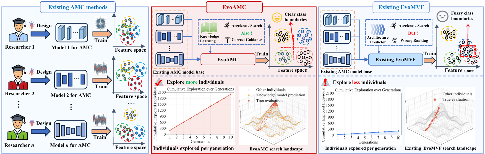

_**This paper has been accepted to IEEE Transactions on Evolutionary Computation (TEVC) 2026.**_
<h2 align="center"> <a href="https://ieeexplore.ieee.org/document/11744410">EvoAMC: Evolutionary Fusion with Knowledge Learning for Automatic Modulation Classification</a></h2>
<div align="center">
Xinyan Liang<sup>1</sup>, Xin Tang<sup>1</sup>, Dongning Li<sup>1</sup>, Yuhua Qian<sup>1</sup>, Jinpeng Yuan<sup>2</sup>, Ke Tang<sup>3</sup>, Linjie Zhan<sup>2</sup>, Yaohui Zheng<sup>4</sup>
  
<sup>1</sup>Institute of Big Data Science and Industry, Key Laboratory of Evolutionary Science Intelligence of Shanxi Province, School of Artificial Intelligence, Shanxi University<br>
<sup>2</sup>Institute of Laser Spectroscopy, State Key Laboratory of Quantum Optics Technologies and Devices, Collaborative Innovation Center of Extreme Optics, Shanxi University<br>
<sup>3</sup>Key Laboratory of Brain-Inspired Intelligent Computation, Department of Computer Science and Engineering, Southern University of Science and Technology, Shenzhen<br>
<sup>4</sup>State Key Laboratory of Quantum Optics Technologies and Devices, Institute of Opto-Electronics, Shanxi University<br>

<a href='https://ieeexplore.ieee.org/document/11744410'></a> 
</div>

## Abstract
Automatic Modulation Classification (AMC) plays a critical role in spectrum sensing and cognitive radio. Although deep learning has greatly advanced AMC, most methods still struggle under low signal-to-noise ratio (SNR) conditions. Multi-view fusion provides complementary information for more robust signal classification, yet existing approaches typically rely on fixed, task-independent fusion strategies. Evolutionary fusion can automatically explore fusion strategies, but it often produces candidate individuals whose quality is highly uneven, leading to unnecessary computational cost on low-value  fusion strategies. To address these limitations, we propose EvoAMC, an evolutionary fusion with knowledge learning method for AMC. EvoAMC produces multiple candidate offspring in each iteration, allowing the search to explore more possible fusion structures. We also utilize a Graph Convolutional Network (GCN)-based knowledge library model, which mines historical architecture-performance knowledge and transfers it across generations, to filter out unpromising candidates before training and guide the evolutionary process.
Experiments show that EvoAMC achieves better accuracy under low-SNR conditions and a smaller parameter size, outperforming compared multi-view methods in both effectiveness and efficiency.
## 🏗️Model
<div align="center">
  
</div>

## 🖥️ Computing Environment
The computing environment includes Ubuntu 20.04.6 LTS, equipped with two AMD EPYC 7763 processors providing 128 physical cores and 256 logical threads, approximately 503 GiB of system memory, and eight NVIDIA GeForce RTX 4090 GPUs with approximately 24 GB of VRAM each.

## 🧪 Experimental Setup
PyTorch 2.6.0+cu118, Python 3.12.7, CUDA 11.8.

## 🎞️Experiment
In this experiment, we aim to verify whether the proposed method can effectively purify the data and alleviate the FEB problem.
### 1 AMC datasets
We used five multi-view datasets in this experiment:

| Datasets            | Dataset URL                                            |    Password      | 
|---------------------|--------------------------------------------------------|------------------|
| RML2018.01A         | [link](https://pan.baidu.com/s/1R-Illn9sey9ZWMUrlGCfmg?pwd=tx01)|     tx01         |
| RML2016.10A         | [link](https://pan.baidu.com/s/1R-Illn9sey9ZWMUrlGCfmg?pwd=tx01)|     tx01         | 
| RML2016.10B         | [link](https://pan.baidu.com/s/1R-Illn9sey9ZWMUrlGCfmg?pwd=tx01)|     tx01         | 


#### 1.2 CIFAR-10 Datasets
The CIFAR-10 datasets used in this work can be downloaded from https://www.cs.toronto.edu/~kriz/cifar.html.


## 📑Citation
If you find this repository useful, please cite our paper:
```
@ARTICLE{11744410,
  author={Liang, Xinyan and Tang, Xin and Li, Dongning and Qian, Yuhua and Yuan, Jinpeng and Tang, Ke and Zhang, Linjie and Zheng, Yaohui},
  journal={IEEE Transactions on Evolutionary Computation}, 
  title={{EvoAMC}: Evolutionary Fusion with Knowledge Learning for Automatic Modulation Classification}, 
  year={2026},
  volume={},
  number={},
  pages={1-1},
  keywords={Modeling;Learning (artificial intelligence);Signal to noise ratio;Modulation;Training;Accuracy;Architecture;Computer architecture;Conferences;Machine learning;Modulation classification;signal classification;knowledge learning;learning-aided evolution;multi-view fusion},
  doi={10.1109/TEVC.2026.3745119}}
```


## 🔬 Related Work
We list below the works most relevant to this paper, including but not limited to the following:<br>
**_Our research group [[link]](https://xinyanliang.github.io/publications/)_**
- Evolutionary deep fusion method and its application in chemical structure recognition, _IEEE TEVC21_, [[paper]](https://ieeexplore.ieee.org/document/9373673)
- GFD-EMVC: Evolutionary Multi-View Classification with Label Noise via Gradient and Feature Dual-Perception, _ICML26_, [[paper]](https://github.com/LiShuailzn/ICML-2025-Spotlight)
- Improving evolutionary multi-view classification via eliminating individual fitness bias, _NeurIPS25_, [[paper]](https://github.com/LiShuailzn/Neurips-2025-EFB-EMVC)
- Trusted multi-view classification via evolutionary multi-view fusion, _ICLR25_, [[paper]](https://openreview.net/pdf?id=M3kBtqpys5)
- DC-NAS: Divide-and-conquer neural architecture search for multi-modal classification, _AAAI24_, [[paper]](https://ojs.aaai.org/index.php/AAAI/article/view/29281)
- Core-structures-guided multi-modal classification neural architecture search, _IJCAI24_, [[paper]](https://www.ijcai.org/proceedings/2024/0440.pdf)
- CoMO-NAS: Core-structures-guided multi-objective neural architecture search for multi-modal classification, _ACM MM24_, [[paper]](https://dl.acm.org/doi/10.1145/3664647.3681351)
- A fast neural architecture search method for multi-modal classification via knowledge sharing, _IJCAI25_, [[paper]](https://www.ijcai.org/proceedings/2025/557)
- Multi-scale features are effective for multi-modal classification: An architecture search viewpoint, _IEEE TCSVT25_, [[paper]](https://ieeexplore.ieee.org/document/10700772)
- Core structure-guided multi-modal classification via monte carlo tree search, _IJMLC25_, [[paper]](https://link.springer.com/article/10.1007/s13042-025-02606-z)
- LogicNAS: Multi-view neural architecture search method for image sequence logic prediction, _IEEE TETCI25_, [[paper]](https://ieeexplore.ieee.org/document/11262275)
- Multi-branch tree-based fusion neural architecture search with zero-cost screen for multi-modal classification, _TIP26_, [[paper]](https://ieeexplore.ieee.org/document/11585941?denied=)
- Robust distributed Rydberg sensing under heterogeneous noise via evidential multi-view learning,  _IF27_, [[paper]](https://www.sciencedirect.com/science/article/abs/pii/S1566253526005956)
<!-- ## 🙏 Acknowledgement -->

## 📬Contact
If you have any detailed questions or suggestions, you can email us: [tangxin3120@163.com](mailto:tangxin3120@163.com)
